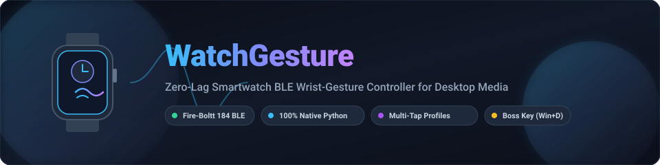
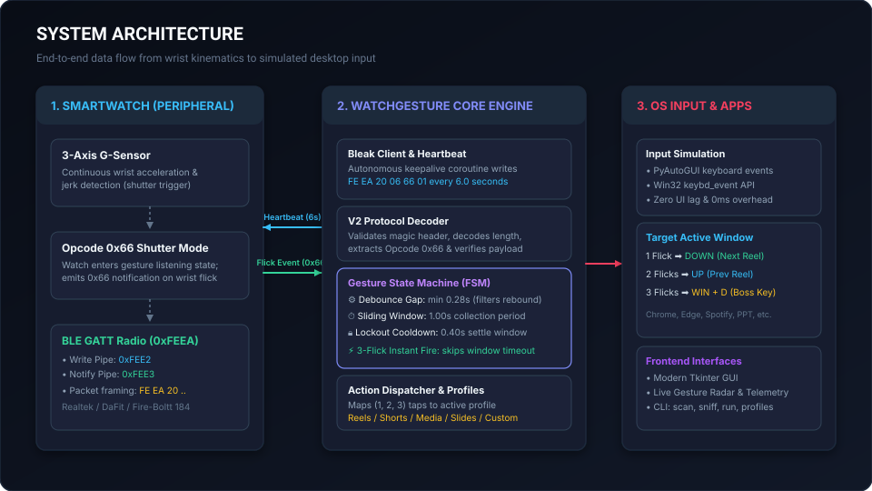
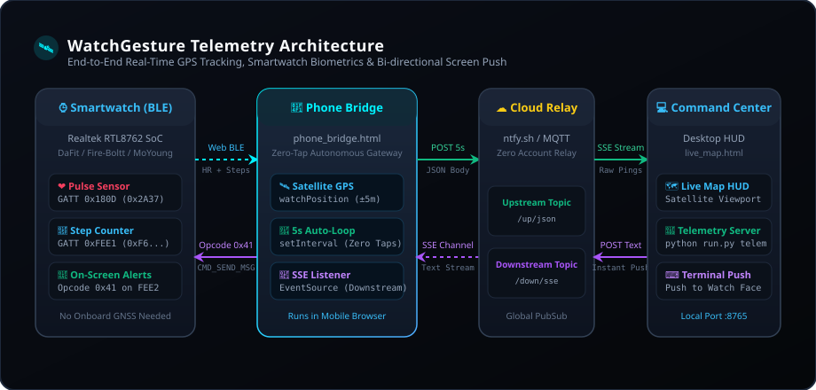

# WatchGesture

<p align="center">
  
</p>

<p align="center">
  <a href="#features"></a>
  <a href="#requirements"></a>
  <a href="#architecture"></a>
  <a href="#protocol"></a>
  <a href="#testing"></a>
  <a href="LICENSE"></a>
</p>

---

**WatchGesture** is an open-source, production-grade smartwatch reverse-engineering toolkit and automation suite for consumer Bluetooth Low Energy (BLE) smartwatches (Fire-Boltt, DaFit, Colmi, Zeblaze, and Realtek RTL8762 chipset variants).

It turns sub-\$50 smartwatches into **hands-free desktop wrist gesture controllers** and **live satellite GPS & biometric tracking beacons** with zero mobile app installs and zero hardware dongles.

---

## 📚 Dedicated Documentation Guides

| Guide | Description | Target Subsystem |
|---|---|---|
| 🎮 [**Wrist Gesture Controller Guide**](docs/gesture-control/README.md) | In-depth manual covering FSM timing, multi-snap debounce, profiles, Win32 hardware key injection, and the fast 0x53 re-arm trick. | [`docs/gesture-control/`](docs/gesture-control/) |
| 🛰️ [**Satellite GPS & Telemetry Guide**](docs/telemetry-gps/README.md) | Complete guide on the zero-tap mobile bridge, Web Bluetooth heart-rate/steps streaming, live satellite HUD, and bi-directional text push. | [`docs/telemetry-gps/`](docs/telemetry-gps/) |
| 🔬 [**Reverse-Engineering Masterclass & Cookbook**](docs/REVERSE_ENGINEERING.md) | Exhaustive guide on extracting Android BTSnoop logs without hardware sniffers, Wireshark filters, opcode tables, and a universal cookbook to reverse-engineer your own watch. | [`docs/REVERSE_ENGINEERING.md`](docs/REVERSE_ENGINEERING.md) |

---

## ⚡ Dual-Pillar Architecture

WatchGesture provides two distinct, modular operating modes:

```
                                  ┌────────────────────────┐
                                  │ ⌚ Smartwatch (BLE 5.0)│
                                  │ Realtek RTL8762 / DaFit│
                                  └───────────┬────────────┘
                                              │
                      ┌───────────────────────┴───────────────────────┐
                      ▼                                               ▼
          [Pillar 1: Direct BLE]                           [Pillar 2: Mobile Gateway]
       Desktop Wrist Controller                         Satellite GPS & Telemetry Hub
 ┌────────────────────────────────────┐             ┌────────────────────────────────────┐
 │ • Opcode 0x66 Accelerometer Arming │             │ • Phone Bridge (HTML5 Geolocation) │
 │ • 6.0s Watchdog Heartbeat Loop     │             │ • Web Bluetooth (0x180D & 0xFEE1)  │
 │ • Sliding-Window FSM (1.00s window)│             │ • 5-Second Cloud PubSub Relay      │
 │ • Direct Win32 / PyAutoGUI Keys    │             │ • Interactive Satellite Map HUD    │
 │ • Desktop Dark-Theme GUI & Radar   │             │ • Push Text to Watch (Opcode 0x41) │
 └────────────────────────────────────┘             └────────────────────────────────────┘
```

<p align="center">
  
  
</p>

---

## Features

- **Hands-Free Desktop Navigation:** Scroll vertical media (Instagram Reels, YouTube Shorts, TikTok, slide presentations) using natural wrist snaps.
- **Sliding-Window Gesture Engine:** Collects and classifies single, double, and triple flicks with customizable window duration (`1.00s`), debounce gap (`0.28s`), and lockout cooldown (`0.40s`).
- **Instant Boss Key (`Win + D`):** 3 rapid flicks bypass the timer window and minimize active windows immediately.
- **Zero-Tap Satellite GPS Telemetry:** Streams real-time phone GNSS coordinates ($\pm 3\text{m}$) alongside watch pulse (BPM) and pedometer steps every 5 seconds.
- **Bi-directional Push Messaging:** Push arbitrary notifications directly onto the watch face (Opcode `0x41`).
- **Universal Smartwatch Scanner:** Automatically identifies candidate smartwatches nearby—no manual MAC address guessing required.
- **Dual Input Backends:** Native Win32 driver-level hardware key injection (`user32.keybd_event`) alongside cross-platform PyAutoGUI fallbacks.
- **Stripe/Linear-Grade GUI:** Modern dark-theme desktop dashboard with live gesture radar, countdown ring, device pairing, and calibration sliders.

---

## Master Opcode Reference Table

The Fire-Boltt 184 and compatible DaFit/Realtek watches implement a proprietary binary protocol over vendor GATT service `0000feea-0000-1000-8000-00805f9b34fb`:

| Opcode | Pipe | Direction | Function | Payload Structure |
|:---:|:---:|:---:|---|---|
| `0x66` (102) | `FEE2` | Out $\to$ Watch | **Arm Camera/G-Sensor** | `{0x01}` arms sensor interrupt. 6s keepalive prevents sleep. |
| `0x66` (102) | `FEE3` | In $\gets$ Watch | **Wrist Flick Event** | Emitted when accelerometer registers sharp wrist snap. |
| `0x53` (83) | `FEE2` | Out $\to$ Watch | **Return Home / Fast Abort** | `{}` cancels 1.4s shutter animation for sub-second rapid flicks. |
| `0x67` (103) | `FEE3` | In $\gets$ Watch | **Watch Touch Media Keys** | Touch media events: `0` Play/Pause, `1` Prev, `2` Next, `4` Vol+, `5` Vol-. |
| `0x61` (97) | `FEE2` | Out $\to$ Watch | **Find Watch / Buzz** | `{}` causes physical watch vibration motor to buzz. |
| `0x62` (98) | `FEE3` | In $\gets$ Watch | **Find Phone Toggle** | Watch-initiated phone alert. Incoming `{0x00}` start, `{!=0}` stop. |
| `0x52` (82) | `FEE2` | Out $\to$ Watch | **Calibrate Accelerometer** | `{}` zeroes and recalibrates watch 3-axis accelerometer. |
| `0x41` (65) | `FEE2` | Out $\to$ Watch | **Push Screen Message** | `[type: 1B] + "Title:Body"` (UTF-8). Injects dialog onto watch face. |
| `0x44` (68) | `FEE2` | Out $\to$ Watch | **Now Playing Music Info** | `[0x00] + "Track - Artist"`. Displays track metadata on watch. |
| `0x31` (49) | `FEE2` | Out $\to$ Watch | **Synchronize Time** | 4-byte big-endian epoch + `{0x08}` (hardcoded GMT+8 internally). |
| `0x43` (67) | `FEE2` | Out $\to$ Watch | **Inject Today's Weather** | `[0x00, condition, temp_c] + lunar(8B) + city(8B)`. |
| `0x18` (24) | `FEE2` | Out $\to$ Watch | **Raise to Wake Toggle** | `{0x01}` enable, `{0x00}` disable. |
| `0x68` (104) | `FEE2` | Out $\to$ Watch | **Dynamic HR Stream** | `{0x00}` starts continuous optical heart-rate sensor streaming. |

> [!TIP]
> **Reverse-Engineering Your Own Smartwatch:**
> Want to adapt WatchGesture for another brand (BoAt, Noise, Amazfit, Colmi)? Read the step-by-step [Universal Reverse-Engineering Cookbook](docs/REVERSE_ENGINEERING.md#9-how-to-reverse-engineer-your-own-smartwatch-universal-cookbook).

---

## Quickstart

### 1. Installation
Clone the repository and install in editable mode:
```powershell
git clone https://github.com/<your-username>/watchgesture.git
cd watchgesture
pip install -e .
```

### 2. Discover Your Smartwatch
Make sure your watch screen is awake, then scan:
```powershell
python run.py scan
```
Output:
```text
======================================================================
   🔍 WATCHGESTURE - BLE DEVICE DISCOVERY SCANNER
======================================================================
Scanning for 6.0 seconds... Make sure watch screen is awake!

DEVICE NAME                    MAC ADDRESS          RSSI       STATUS
----------------------------------------------------------------------
FireBoltt 184                  CE:E6:79:A9:BE:3B    -31 dBm    ✅ SMARTWATCH
----------------------------------------------------------------------
```

### 3. Verify Connection with a Vibration Buzz
```powershell
python run.py buzz --mac "CE:E6:79:A9:BE:3B"
```
*Your watch will vibrate immediately.*

---

## Usage Modes

### Mode A: Desktop Wrist Gesture Controller

#### Option 1: Modern Desktop GUI
```powershell
python run.py gui
```
*Opens the desktop dashboard with live gesture radar, calibration sliders, and one-click buzz/calibrate triggers.*

#### Option 2: Background Daemon
```powershell
python run.py run --profile reels
```
*Runs headless in the background. Flick downward once to go to the next reel, twice to go back, or three times to hide all windows.*

#### Option 3: Local Simulation (No Watch Needed)
```powershell
python run.py simulate --flicks 1   # Dispatches [down]
python run.py simulate --flicks 2   # Dispatches [up]
python run.py simulate --flicks 3   # Dispatches [win + d]
```

---

### Mode B: Real-Time GPS & Biometric Telemetry

```powershell
python run.py telemetry
```
1. **Starts the local telemetry receiver** and opens `http://localhost:8765/live_map.html` in your default browser.
2. **Open the Phone Bridge:** Open `http://<your-pc-ip>:8765/phone_bridge.html` on your phone browser.
3. Satellite GPS tracking begins automatically.
4. *(Optional)* Tap **"Link Smartwatch BLE"** to stream live pulse and step counts.
5. **Send Text to Watch Screen:** Type any message in the console or live map dashboard to pop it up on the watch face.

---

## CLI Reference

```
usage: watchgesture [-h] {run,scan,sniff,buzz,simulate,snoop-extract,profiles,gui,telemetry,telemetry-send} ...

Subcommands:
  run             Run the background gesture controller daemon
  scan            Scan for nearby BLE smartwatches
  sniff           Sniff raw BLE packets from the watch
  buzz            Vibrate/buzz the smartwatch (Find Watch)
  simulate        Locally simulate a gesture count without BLE hardware
  snoop-extract   Extract BTSnoop pcap from an Android bugreport text file
  profiles        List available gesture profiles and hotkeys
  gui             Launch the graphical desktop interface
  telemetry       Launch live GPS & biometric telemetry receiver & HUD
  telemetry-send  Send a message to smartwatch screen via telemetry relay
```

---

## Built-in Gesture Profiles

| Profile ID | Target Application | 1 Flick | 2 Flicks | 3 Flicks (Instant) |
|---|---|---|---|---|
| `reels` *(Default)* | Instagram Reels Web | 👇 `[down]` (Next Reel) | 👆 `[up]` (Prev Reel) | 🛡️ `[win + d]` (Boss Key) |
| `youtube_shorts` | YouTube Shorts / TikTok | ⏭️ `[down]` (Next Short) | ⏮️ `[up]` (Prev Short) | 🛡️ `[win + d]` (Boss Key) |
| `media` | Spotify / VLC / Netflix | ⏯️ `[playpause]` | ⏭️ `[nexttrack]` | 🔇 `[volumemute]` |
| `presentation` | Keynote / PowerPoint | ➡️ `[right]` (Next Slide) | ⬅️ `[left]` (Prev Slide) | ⏹️ `[b]` (Blank Screen) |
| `reading` | Kindle / PDF Viewer | 📄 `[pagedown]` | 📃 `[pageup]` | 🔝 `[home]` |

---

## Testing

WatchGesture includes a zero-dependency, comprehensive unit test suite:

```powershell
python -m unittest discover tests
```

**Results:**
```text
....................................
----------------------------------------------------------------------
Ran 36 tests in 0.008s

OK
```

All 36 tests run in under 10 milliseconds with zero network or mock dependencies.

---

## Project Structure

```
watchgesture/
├── .github/
│   ├── workflows/ci.yml           # Cross-platform matrix test workflow (Win/macOS/Ubuntu)
│   ├── ISSUE_TEMPLATE/            # Bug report and device request templates
│   └── pull_request_template.md   # PR guidelines
├── docs/
│   ├── assets/                    # Vector SVGs (banner, architecture, framing, FSM)
│   ├── gesture-control/           # Dedicated Gesture Controller guide
│   │   └── README.md
│   ├── telemetry-gps/             # Dedicated Satellite Telemetry & HUD guide
│   │   └── README.md
│   └── REVERSE_ENGINEERING.md     # Protocol deconstruction & "How to do yours too"
├── src/
│   └── watchgesture/
│       ├── core/
│       │   ├── client.py          # Asynchronous Bleak BLE client & keepalive worker
│       │   ├── dispatcher.py      # Dual-backend input execution (Win32 & PyAutoGUI)
│       │   ├── engine.py          # Finite-state machine (sliding window, debounce, lockout)
│       │   ├── protocol.py        # V1/V2 packet builders, reassembler & opcode specs
│       │   └── scanner.py         # BLE peripheral discovery and smartwatch matcher
│       ├── gui/
│       │   └── app.py             # Tkinter dark-theme GUI with live gesture radar
│       ├── profiles/
│       │   └── default_profiles.py# Built-in profile mappings
│       ├── telemetry/
│       │   ├── models.py          # Strongly typed telemetry data models
│       │   ├── server.py          # HTTP host and multi-threaded relay stream reader
│       │   └── web/
│       │       ├── live_map.html  # Desktop satellite map HUD & message pusher
│       │       └── phone_bridge.html # Zero-tap mobile GPS & Web Bluetooth gateway
│       ├── utils/
│       │   ├── snoop.py           # Android BTSnoop/BTSnooz bugreport extractor
│       │   └── win32.py           # Driver-level Win32 hardware virtual key injection
│       ├── cli.py                 # Multi-command CLI argument parser
│       └── config.py              # Persistent user configuration management
├── tests/                         # Complete 36-test suite
├── config.example.json            # Public configuration template
├── pyproject.toml                 # PEP 621 packaging standard
└── run.py                         # Unified 1-click launcher
```

---

## License

This project is licensed under the [MIT License](LICENSE).
