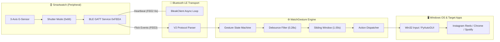
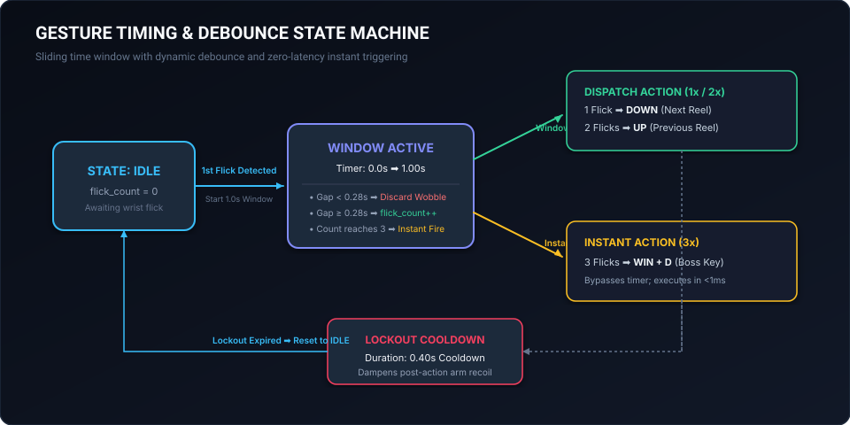
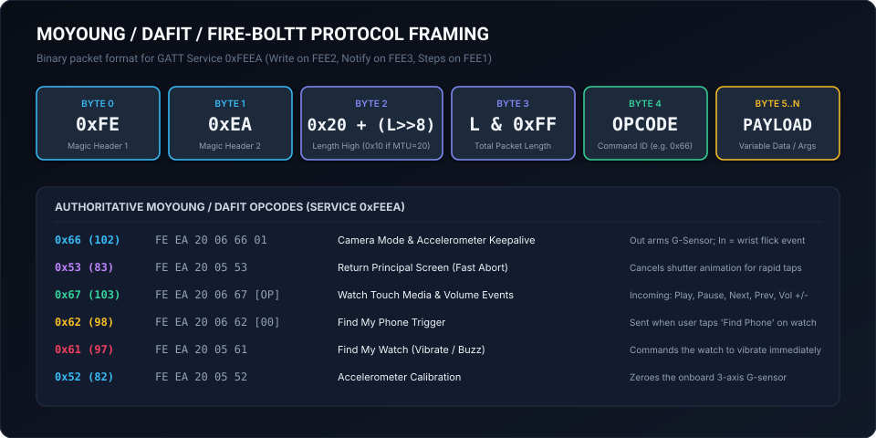
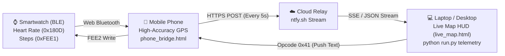

# WatchGesture

<p align="center">
  
</p>

<p align="center">
  <a href="#features"></a>
  <a href="#requirements"></a>
  <a href="#architecture"></a>
  <a href="#protocol"></a>
  <a href="#testing"></a>
  <a href="LICENSE"></a>
</p>

---

**WatchGesture** is a high-performance, modular Bluetooth Low Energy (BLE) gesture controller that turns smartwatches (Fire-Boltt 184, DaFit, Moyoung, and Realtek RTL8762 chipset variants) into hands-free input controllers for desktop media and applications.

By reverse-engineering the watch's internal GATT camera-shutter mode (`0x66` on vendor service `0xFEEA`), WatchGesture keeps the watch's 3-axis accelerometer streaming and translates wrist flicks into simulated keyboard and media actions with sub-millisecond response latency.

---

## Table of Contents

- [Features](#features)
- [System Architecture](#system-architecture)
- [Gesture Timing & State Machine](#gesture-timing--state-machine)
- [Reverse-Engineering the Protocol](#reverse-engineering-the-protocol)
- [Gesture Profiles](#gesture-profiles)
- [Quick Start](#quick-start)
- [CLI Reference](#cli-reference)
- [Graphical User Interface (GUI)](#graphical-user-interface-gui)
- [Project Structure](#project-structure)
- [Testing](#testing)
- [Troubleshooting & FAQ](#troubleshooting--faq)
- [License](#license)

---

## Features

- **Hands-Free Desktop Control:** Scroll vertical media (Instagram Reels, YouTube Shorts, TikTok) without touching mouse or keyboard.
- **Sliding-Window Gesture Engine:** Collects and classifies single, double, and triple flicks with customizable window duration (`1.00s`), debounce gap (`0.28s`), and lockout cooldown (`0.40s`).
- **Instant Boss Key (`Win + D`):** 3 rapid flicks bypass the timing window and fire instantly to minimize work applications.
- **Auto-Discovery BLE Scanner:** Detects and flags supported smartwatches nearby—no manual MAC address guessing required.
- **Modular Profile Matrix:** Seamlessly switch between built-in profiles (Reels, YouTube Shorts, Media Player, Keynote/Presentations, Document Reader) or define custom key combinations.
- **Dual Input Backends:** Dispatches simulated inputs via PyAutoGUI and direct native Win32 hardware virtual keys (`user32.keybd_event`) for full-screen game and browser compatibility.
- **Linear/Stripe-Grade GUI:** Modern dark-theme desktop interface with live gesture radar, countdown progress ring, device pairing, and real-time telemetry log.

---

## System Architecture

<p align="center">
  
</p>



The system operates across three decoupled layers:
1. **Peripheral Layer:** The smartwatch firmware arms its accelerometer upon receiving command `0x66` on characteristic `FEE2`. When physical wrist acceleration exceeds the firmware's internal threshold, the watch emits an event on notify pipe `FEE3`.
2. **Core Engine Layer:** An asynchronous `BleakClient` worker writes a heartbeat every 6 seconds to prevent the watch from returning to sleep. Incoming notifications are parsed, debounced against arm vibrations, and accumulated in a sliding window.
3. **Execution Layer:** Completed gestures are dispatched to active application windows via PyAutoGUI and native Win32 `keybd_event` calls.

---

## Gesture Timing & State Machine

<p align="center">
  
</p>

Physical wrist movements produce residual vibrations ("rebound wobble") after the initial snap. WatchGesture solves false multi-triggers using a deterministic 3-phase finite-state machine:

| Parameter | Default | Purpose |
|---|---:|---|
| `gesture_window_sec` | `1.00s` | Time window opened on the first flick to accumulate additional flicks. |
| `min_gap_sec` | `0.28s` | Minimum required physical spacing between flicks. Discards wrist rebound. |
| `lockout_duration_sec` | `0.40s` | Post-action cooldown during which all G-sensor events are ignored. |

### Evaluation Rules:
- **1 Flick:** Window opens at $T=0$. If no further flicks arrive before $T=1.00\text{s}$, the single-flick action (`Down / Next Reel`) executes, followed by a $0.40\text{s}$ lockout.
- **2 Flicks:** Second flick arrives at $T \ge 0.28\text{s}$ and $T < 1.00\text{s}$. At $T=1.00\text{s}$, the double-flick action (`Up / Previous Reel`) executes.
- **3 Flicks (Instant Trigger):** Third flick arrives before window expiration. The engine triggers the Boss Key (`Win + D`) immediately without waiting for the timer to expire.

---

## Reverse-Engineering the Protocol

<p align="center">
  
</p>

The Fire-Boltt 184 and compatible DaFit/Moyoung watches implement a proprietary binary protocol over vendor service UUID `0000feea-0000-1000-8000-00805f9b34fb`.

> [!TIP]
> **Complete Reverse-Engineering Guide Available:**
> For an in-depth, step-by-step masterclass covering Android Bluetooth HCI snoop extraction without hardware dongles, Wireshark display filters, packet deconstruction, and how the G-sensor shutter interrupt was discovered, read the [Reverse-Engineering Master Guide](docs/REVERSE_ENGINEERING.md).

### GATT Characteristics

| UUID | Handle | Properties | Role in WatchGesture |
|---|---|---|---|
| `0000fee2-0000-1000-8000-00805f9b34fb` | `FEE2` | `WRITE_WITHOUT_RESPONSE` | Control write pipe (heartbeats, mode arming, buzz, calibrate) |
| `0000fee3-0000-1000-8000-00805f9b34fb` | `FEE3` | `NOTIFY` | Sensor event notification pipe (wrist flicks, media buttons, find phone) |
| `0000fee1-0000-1000-8000-00805f9b34fb` | `FEE1` | `READ / NOTIFY` | Live pedometer / steps data |
| `0000fee6-0000-1000-8000-00805f9b34fb` | `FEE6` | `WRITE_WITHOUT_RESPONSE` | Bulk data pipe (watch face assets, chunk transfers) |
| `00002a19-0000-1000-8000-00805f9b34fb` | `2A19` | `READ / NOTIFY` | Standard BLE Battery Level |
| `00002a29-0000-1000-8000-00805f9b34fb` | `2A29` | `READ` | Manufacturer Name (`MOYOUNG-V2`) |

### Packet Structure (V1 & V2 Framing)

All frames start with magic header `0xFE 0xEA`:

```
+------------+------------+--------------------+------------+------------+--------------------+
|   Byte 0   |   Byte 1   |       Byte 2       |   Byte 3   |   Byte 4   |     Byte 5..N      |
+------------+------------+--------------------+------------+------------+--------------------+
|    0xFE    |    0xEA    | 0x20 + (Total >> 8)| Total & FF |   Opcode   |  Payload (Optional)|
+------------+------------+--------------------+------------+------------+--------------------+
```

- **Byte 0–1:** Protocol identifier (`0xFE 0xEA`).
- **Byte 2:** Total length high byte tagged with mask `0x20` (or `0x10` if MTU=20).
- **Byte 3:** Total length low byte ($5 + \text{len(payload)}$).
- **Byte 4:** Command Opcode.
- **Byte 5..N:** Variable length payload.

### Authoritative MoYoung / DaFit Opcodes

| Opcode | Hex | Direction | Description |
|---|---|---|---|
| `102` | `0x66` | Out / In | **Camera Shutter / G-Sensor**: Out arms sensor; In = wrist flick event |
| `83` | `0x53` | Out / In | **Return Home**: Cancels shutter animation for rapid multi-taps |
| `103` | `0x67` | In | **Watch Touch Media Controls**: Play/Pause (`0`), Next (`2`), Prev (`1`), Vol+ (`4`), Vol- (`5`) |
| `98` | `0x62` | In | **Find Phone Trigger**: Sent when user taps "Find Phone" on watch screen |
| `97` | `0x61` | Out | **Find Watch**: Commands the watch to vibrate / buzz |
| `82` | `0x52` | Out | **Zero G-Sensor**: Calibrates the onboard 3-axis accelerometer |
| `65` | `0x41` | Out | **Push Notification**: Pushes text message (`Title:Body`) to watch screen |
| `68` | `0x44` | Out | **Media Info**: Pushes track title and artist string to watch display |
| `24` | `0x18` | Out | **Quick View**: Enables (`0x01`) or disables (`0x00`) Raise-to-Wake |

### Ground-Truth Packets

```bash
# Keepalive Heartbeat (Write to FEE2 every 6s):
FE EA 20 06 66 01

# Wrist Flick Notification (Received on FEE3):
FE EA 20 06 66 01

# Fast Shutter Animation Cancel (Write to FEE2):
FE EA 20 05 53

# Quick-View / Raise-To-Wake Enable (Write to FEE2):
FE EA 20 06 18 01
```

---

## Gesture Profiles

WatchGesture includes predefined profiles tuned for popular applications:

| Profile ID | Profile Name | 1 Flick (1.0s) | 2 Flicks (1.0s) | 3 Flicks (Instant) |
|---|---|---|---|---|
| `reels` *(Default)* | Instagram Reels | 👇 Scroll Down (`down`) | 👆 Scroll Up (`up`) | 🛡️ Boss Key (`win + d`) |
| `youtube_shorts` | YouTube Shorts / TikTok | 👇 Next Video (`down`) | 👆 Prev Video (`up`) | 🔇 Mute / Unmute (`m`) |
| `media` | Media Player & Spotify | ⏯️ Play / Pause (`space`) | ⏭️ Next Track (`nexttrack`) | 🔇 System Mute (`volumemute`) |
| `presentation` | Keynote & Slides | 👉 Next Slide (`right`) | 👈 Prev Slide (`left`) | ⬛ Blank Screen (`b`) |
| `reading` | Long Document Reader | 📄 Page Down (`pagedown`) | 📃 Page Up (`pageup`) | 🔝 Jump to Top (`home`) |

---

## Quick Start

### 1. Requirements

- **OS:** Windows 10 or 11 with Bluetooth 4.0+ BLE hardware.
- **Python:** Python 3.9, 3.10, 3.11, or 3.12.
- **Hardware:** Fire-Boltt 184 (or DaFit / Moyoung compatible smartwatch).

### 2. Installation

Clone the repository and install dependencies:

```powershell
# Navigate into the project folder
cd "c:\personel projects\ble\watchgesture project"

# Create a virtual environment (optional but recommended)
python -m venv .venv
.\.venv\Scripts\Activate.ps1

# Install dependencies
pip install -r requirements.txt
```

### 3. Launching

Launch the **Graphical Interface**:
```powershell
python run.py
```

Or run directly from the command line:
```powershell
# Auto-detect smartwatch and run with Instagram Reels profile
python run.py run

# Scan for nearby smartwatches and print their MAC addresses
python run.py scan
```

---

## CLI Reference

The `watchgesture` command-line interface provides comprehensive tools for scanning, testing, and running controllers:

```
usage: watchgesture [-h] {run,scan,sniff,buzz,simulate,snoop-extract,profiles,gui,telemetry,telemetry-send} ...

Subcommands:
  run             Run the background gesture controller daemon
  scan            Scan for nearby BLE smartwatches
  sniff           Sniff raw BLE packets from the watch
  buzz            Vibrate/buzz the smartwatch (Find Watch)
  simulate        Locally simulate a gesture count without BLE hardware
  snoop-extract   Extract BTSnoop pcap from an Android bugreport text file
  profiles        List available gesture profiles and hotkeys
  gui             Launch the graphical desktop interface
  telemetry       Launch live GPS & biometric telemetry receiver & HUD
  telemetry-send  Send a message to smartwatch screen via telemetry relay
```

### Examples

**Simulate 1, 2, or 3 flicks locally without watch hardware:**
```powershell
python run.py simulate --flicks 1
python run.py simulate --flicks 2
python run.py simulate --flicks 3
```

**Buzz the watch to test physical connection:**
```powershell
python run.py buzz --mac "CE:E6:79:A9:BE:3B"
```

**Extract BTSnoop pcap from Android bugreport:**
```powershell
python run.py snoop-extract bugreport.txt -o capture.pcap
```

**Scan for smartwatches:**
```powershell
python -m watchgesture scan --timeout 8.0
```

---

## 🛰️ Real-Time GPS & Biometric Telemetry

In addition to wrist gesture media control, WatchGesture includes a zero-tap **mobile telemetry bridge and desktop HUD**:



### How to Use Telemetry:

1. **Launch the Telemetry Receiver & HUD on PC:**
   ```powershell
   python run.py telemetry
   ```
   *Spins up a local HTTP server at `http://localhost:8765/live_map.html` and opens the live satellite dashboard.*

2. **Open the Mobile Bridge on your Phone:**
   - Open `http://<your-pc-ip>:8765/phone_bridge.html` on your phone browser.
   - GPS satellite tracking starts **automatically** on page load with zero clicks.
   - Tap **"Link Smartwatch BLE"** to stream live watch pulse (BPM) and pedometer steps.

3. **Bi-directional Push Messaging:**
   - Type any text message in the terminal or on the live map dashboard and press **Enter** to pop it up directly onto the watch screen (Opcode `0x41` / `CMD_SEND_MESSAGE`).
   - Or push from the command line:
     ```powershell
     python run.py telemetry-send --message "Dinner is ready!"
     ```

**Run controller with specific MAC and Media profile:**
```powershell
python -m watchgesture run --mac "CE:E6:79:A9:BE:3B" --profile media
```

**Calibrate custom gesture window and gap:**
```powershell
python -m watchgesture run --window 1.20 --gap 0.32 --lockout 0.50
```

**Sniff raw GATT notifications for protocol inspection:**
```powershell
python -m watchgesture sniff --mac "CE:E6:79:A9:BE:3B"
```

---

## Graphical User Interface (GUI)

The WatchGesture GUI is built with modern dark tokens, responsive padding, and non-blocking asynchronous state processing:

- **Live Gesture Radar:** Multi-tap step visualization that flashes action tiles when wrist flicks register.
- **Countdown Window Bar:** High-precision visual progress bar showing remaining window time ($1.00\text{s} \to 0.00\text{s}$).
- **Interactive Device Discovery:** 1-click BLE scanner automatically discovers nearby smartwatches and populates the target address field.
- **Profile Selector:** Switch between Instagram Reels, YouTube Shorts, Spotify Media, and Keynote presentation modes on the fly.
- **Live Event Log:** Timestamped, scrollable activity console for connection diagnostics.

Run the GUI with:
```powershell
python -m watchgesture gui
```

---

## Project Structure

```
watchgesture project/
├── pyproject.toml                     # Modern PEP 621 package specification
├── requirements.txt                   # Production dependencies (bleak, pyautogui)
├── run.py                             # Root quick-launcher script
├── docs/
│   └── assets/
│       ├── banner.svg                 # Project banner vector graphic
│       ├── architecture.svg           # High-resolution architecture diagram
│       ├── state_machine.svg          # Gesture timing & debounce state machine
│       └── protocol_framing.svg       # DaFit V2 binary packet layout
├── src/
│   └── watchgesture/
│       ├── __init__.py                # Package exports and version metadata
│       ├── __main__.py                # python -m watchgesture entrypoint
│       ├── cli.py                     # Rich CLI parser and subcommands
│       ├── config.py                  # JSON configuration and profile persistence
│       ├── core/
│       │   ├── client.py              # BleakClient GATT manager & heartbeat
│       │   ├── dispatcher.py          # Input injector (PyAutoGUI & Win32 VK)
│       │   ├── engine.py              # Gesture state machine (window, debounce, lockout)
│       │   ├── protocol.py            # V2 packet encoder, decoder, opcodes
│       │   └── scanner.py             # BLE device scanner with watch signature filter
│       ├── gui/
│       │   ├── __init__.py
│       │   └── app.py                 # Tkinter dark-theme desktop application
│       ├── profiles/
│       │   ├── __init__.py
│       │   └── default_profiles.py    # Builtin profiles (Reels, Shorts, Media, Slides)
│       └── utils/
│           ├── __init__.py
│           ├── snoop.py               # Android BTSnoop bugreport parser
│           └── win32.py               # Win32 hardware keystroke injector
└── tests/
    ├── __init__.py
    ├── test_config.py                 # Configuration persistence & profile tests
    ├── test_dispatcher.py             # Action lookup and key dispatch tests
    ├── test_engine.py                 # Timing window, debounce, and lockout tests
    ├── test_protocol.py               # V2 packet framing, checksum, opcode tests
    └── test_snoop.py                  # BTSnoop extraction and decoding tests
```

---

## Testing

The project includes unit tests for protocol parsing, gesture state machine timing, configuration serialization, and input dispatching:

```powershell
# Run the complete test suite
python -m unittest discover tests
```

Expected output:
```
..............................
----------------------------------------------------------------------
Ran 30 tests in 0.012s

OK
```

---

## Troubleshooting & FAQ

#### 1. Watch not found during scan or connection
- Ensure the watch screen is **awake and unlocked** when initiating the connection.
- Disconnect the official mobile companion app (DaFit) on your smartphone. Smartwatches can only maintain **one active BLE central connection** at a time.
- If previously paired in Windows Settings, toggle your PC's Bluetooth off and back on.

#### 2. Keystrokes are not registering in the browser
- Click on the browser window (or directly on the Instagram Reel) so the browser document has active OS focus.
- The default Reels profile sends `Down` and `Up` arrow keys, which Instagram uses for reel progression.

#### 3. Single wrist flick triggers two actions
- Your wrist movement may have had a severe rebound bounce. Increase the debounce threshold using `--gap 0.35` or calibrate `min_gap_sec` in `config.json`.

---

## License

This project is licensed under the [MIT License](LICENSE).
