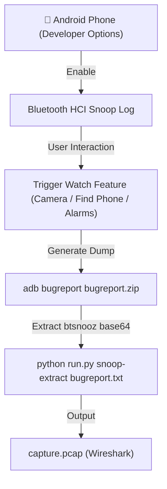

# Smartwatch BLE Protocol Reverse-Engineering Guide

A comprehensive, ground-up guide to reverse-engineering Bluetooth Low Energy (BLE) smartwatches, decoding proprietary vendor GATT protocols, capturing traffic without hardware sniffers, and building desktop automation systems.

---

## Table of Contents

1. [Hardware & Architecture Overview](#1-hardware--architecture-overview)
2. [Zero-Hardware Traffic Capture Pipeline](#2-zero-hardware-traffic-capture-pipeline)
3. [Wireshark Analysis & Filtering Masterclass](#3-wireshark-analysis--filtering-masterclass)
4. [Deconstructing the Packet Framing](#4-deconstructing-the-packet-framing)
5. [The Accelerometer Breakthrough (Opcode 0x66)](#5-the-accelerometer-breakthrough-opcode-0x66)
6. [Live Probing with Python & Bleak](#6-live-probing-with-python--bleak)
7. [Mapping New Opcodes & Payload Layouts](#7-mapping-new-opcodes--payload-layouts)
8. [Common Pitfalls & Protocol Nuances](#8-common-pitfalls--protocol-nuances)

---

## 1. Hardware & Architecture Overview

The Fire-Boltt 184 and the vast majority of consumer smartwatches in the \$20–\$80 category (branded as DaFit, MoYoung, Colmi, Zeblaze, Noise, BoAt, etc.) share a common hardware lineage:

- **Core SoC:** Realtek RTL8762 series (ARM Cortex-M4F, ~40MHz, 160KB RAM, integrated BLE 5.0 transceiver).
- **Motion Sensor:** 3-axis MEMS accelerometer (Bosch BMA421, STMicroelectronics LIS3DH, or Silan Micro SC7A20) linked to the SoC via I²C or SPI.
- **Display Controller:** ST7789 or similar SPI TFT display driver with hardcoded font glyph sets and bitmap framebuffers.
- **Firmware OS:** Lightweight real-time operating system (FreeRTOS or proprietary vendor RTOS) compiled with Realtek SDK.

Because these watches lack an open SDK, all external control relies on their BLE GATT (Generic Attribute Profile) server.

---

## 2. Zero-Hardware Traffic Capture Pipeline

Dedicated RF packet sniffers (like the Ellisys Bluetooth Explorer or Nordic nRF52840 dongles running Wireshark plugins) cost hundreds or thousands of dollars and can drop encrypted connection packets. 

Instead, you can capture **100% of GATT read/write/notify traffic** at the host controller interface (HCI) layer using an Android phone with zero extra hardware.



### Step-by-Step Capture:

1. **Enable Developer Options on Android:**
   - Go to `Settings > About Phone` and tap **Build Number** 7 times.
2. **Enable Bluetooth HCI Snoop Logging:**
   - In `Settings > System > Developer Options`, toggle **Enable Bluetooth HCI snoop log**.
   - Toggle Bluetooth off and back on to initialize the logging ring buffer.
3. **Execute the Target Watch Action:**
   - Open the watch's companion app (e.g. *Da Fit*).
   - Trigger the feature you want to reverse-engineer (for example, tap the **Shutter** icon, change watch face, toggle raise-to-wake, or press "Find My Watch").
   - Take note of the exact time (hour, minute, second) you performed the action.
4. **Dump the Bug Report:**
   - Connect your phone to your PC via USB with USB Debugging enabled:
     ```powershell
     adb bugreport bugreport.zip
     ```
   - Unzip the bug report archive and locate the main `.txt` file (usually named `bugreport-<device>-<build>.txt`).
5. **Extract the BTSnoop Log:**
   - Run WatchGesture's built-in extractor:
     ```powershell
     python run.py snoop-extract bugreport.txt -o watch_capture.pcap
     ```
   - This parses the base64-encoded `--- BEGIN:BTSNOOP_LOG_SUMMARY` block, decompresses the zlib streams, reconstructs the packet direction headers, and writes a valid Wireshark PCAP.

---

## 3. Wireshark Analysis & Filtering Masterclass

Open `watch_capture.pcap` in Wireshark. Because the capture contains all phone Bluetooth traffic (audio, Wi-Fi coexistence, scans), applying precise display filters is essential.

### Essential Wireshark Display Filters

| Filter | Purpose |
|---|---|
| `btatt` | Isolates all Attribute Protocol (GATT) packets. |
| `btatt.opcode == 0x12` | Shows all **Write Commands** (Phone $\to$ Watch). |
| `btatt.opcode == 0x1b` | Shows all **Handle Value Notifications** (Watch $\to$ Phone). |
| `btatt.handle == 0x0014` | Filters specifically for writes to characteristic `FEE2`. |
| `btatt.handle == 0x0017` | Filters specifically for notifications on characteristic `FEE3`. |

> [!NOTE]
> **ATT Opcode vs Watch Firmware Opcode:**
> In Wireshark, you will see `ATT Write Command (0x52)` or `ATT Handle Value Notification (0x1b)`. 
> `0x52` is the Bluetooth Core specification ATT write identifier. The **watch's actual command opcode** lives *inside* the ATT Value payload bytes starting at offset 4!

---

## 4. Deconstructing the Packet Framing

Every packet exchanged over vendor service `0xFEEA` adheres to a strict framing structure:

```
Offset:    [0]    [1]         [2]           [3]       [4]       [5..N]
Byte:     0xFE   0xEA   [Length High]   [Length Low] [Opcode]  [Payload...]
```

### Length Field Calculation

The protocol specifies total length as:
$$\text{Total Length} = 5 + \text{len(payload)}$$

The encoding of Byte 2 depends on the negotiated BLE MTU:
- **MTU = 20 (Legacy V1 Framing):**
  - $\text{Byte 2} = \texttt{0x10}$
  - $\text{Byte 3} = \text{Total Length} \ \& \ \texttt{0xFF}$
- **MTU > 20 (Modern V2 Framing, default MTU 247):**
  - $\text{Byte 2} = \texttt{0x20} + (\text{Total Length} \gg 8)$
  - $\text{Byte 3} = \text{Total Length} \ \& \ \texttt{0xFF}$

#### Example 1: Keepalive Packet (`CMD_SWITCH_CAMERA_VIEW = 0x66`, payload `0x01`)
- Payload length = 1 byte.
- Total length = $5 + 1 = 6$ (`0x0006`).
- High length with V2 tag: `0x20 + 0x00 = 0x20`.
- Low length: `0x06`.
- **Packet:** `FE EA 20 06 66 01`

#### Example 2: Return Home / Cancel Animation (`CMD_RETURN_HOME = 0x53`, empty payload)
- Payload length = 0 bytes.
- Total length = $5 + 0 = 5$ (`0x0005`).
- **Packet:** `FE EA 20 05 53`

---

## 5. The Accelerometer Breakthrough (Opcode 0x66)

### The Problem with Smartwatches
Consumer smartwatches run on tiny 180mAh–260mAh lithium polymer batteries. Streaming continuous 50Hz–100Hz raw accelerometer readings over Bluetooth LE would drain the battery in under 3 hours and saturate the radio bandwidth. Consequently, the firmware keeps the G-sensor processing entirely internal.

### The Reverse-Engineering Discovery
By inspecting Wireshark captures when opening the "Remote Shutter" screen in the DaFit companion app, two critical observations were made:

1. **State Arming:** The phone writes `FE EA 20 06 66 01` to `FEE2`. The watch immediately switches its display to a camera icon.
2. **Event Notification:** In camera mode, the watch firmware attaches an interrupt handler to the G-sensor's hardware high-G/jerk threshold. Whenever the wrist is snapped sharply, the watch fires a notification on `FEE3`:
   ```
   [Pipe FEE3] -> FE EA 20 06 66 01
   ```
3. **The 6-Second Timeout:** If no command is received for 6 seconds, the watch display turns off and camera mode disarms.
   - **Solution:** Writing `FE EA 20 06 66 01` every 6.0 seconds creates an autonomous keepalive heartbeat, keeping the G-sensor armed indefinitely without user intervention!

### The Fast Rearm Trick
When the watch detects a flick, it displays a shutter animation for approximately 1.4 seconds, blocking subsequent flick detection.
By sniffing the "Cancel" action when leaving camera mode, opcode `0x53` (`CMD_RETURN_HOME`) was discovered. Transmitting `FE EA 20 05 53` followed 80ms later by `FE EA 20 06 66 01` aborts the animation and re-arms the sensor instantly, unlocking rapid multi-tap gestures.

---

## 6. Live Probing with Python & Bleak

Once candidate opcodes are identified in Wireshark, you can test and confirm their behavior interactively using Python's `bleak` library.

WatchGesture includes a built-in sniffer:

```powershell
python run.py sniff --mac "CE:E6:79:A9:BE:3B"
```

### Custom Interactive Probing Script

You can run this minimal script in a scratch file to send custom commands and observe watch responses:

```python
import asyncio
from bleak import BleakClient

WATCH_MAC = "CE:E6:79:A9:BE:3B"
FEE2_WRITE = "0000fee2-0000-1000-8000-00805f9b34fb"

def make_packet(cmd: int, payload: bytes = b"") -> bytes:
    total = 5 + len(payload)
    return bytes([0xFE, 0xEA, 0x20 + (total >> 8), total & 0xFF, cmd]) + payload

async def probe():
    async with BleakClient(WATCH_MAC) as client:
        print("Connected! Subscribing to notifications...")
        
        def on_notify(char, data):
            print(f"📡 [Pipe {char.uuid[:8]}] -> {bytes(data).hex(' ')}")
            
        for service in client.services:
            for c in service.characteristics:
                if "notify" in c.properties:
                    await client.start_notify(c.uuid, on_notify)

        # Send test command: 0x61 (Find Watch Buzz)
        print("⚡ Sending CMD 0x61 (Find Watch)...")
        await client.write_gatt_char(FEE2_WRITE, make_packet(0x61), response=False)
        await asyncio.sleep(4.0)

asyncio.run(probe())
```

---

## 7. Mapping New Opcodes & Payload Layouts

When exploring uncharted opcodes, follow this reverse-engineering matrix:

### 1. Observe SET vs QUERY Patterns
In the DaFit/MoYoung protocol, setting a value and querying a value typically follow a predictable mathematical delta:
- **Set Alarm Clock:** `CMD_SET = 17 (0x11)`
- **Query Alarm Clock:** `CMD_QUERY = 33 (0x21)` $(\Delta = +16)$
- **Set Raise-to-Wake:** `CMD_SET = 24 (0x18)`
- **Query Raise-to-Wake:** `CMD_QUERY = 40 (0x28)` $(\Delta = +16)$

### 2. Decode Big-Endian vs Little-Endian Gotchas
- **Pedometer Goal:** `CMD_SET_GOAL_STEP (22)` expects a 4-byte **big-endian** integer (`steps.to_bytes(4, 'big')`).
- **Query Step Goal:** The response from `CMD_QUERY_GOAL_STEP (38)` returns a 4-byte **little-endian** integer!

### 3. Screen Text Injection (Opcode 0x41)
When the phone sends notifications to the watch:
- Byte 0 of payload: Message type (`0` = Call, `1` = SMS, `11` = Generic App).
- Remaining bytes: UTF-8 string formatted as `Title:Body`.
- The watch firmware scans for the first colon (`:`) and automatically splits it into header title and body text on screen.

---

## 8. Common Pitfalls & Protocol Nuances

1. **BLE Central Contention:**
   Smartwatches can only maintain a single active BLE connection. If your phone's Bluetooth is connected to the watch, your PC will get an `Access Denied` or `Device Not Found` error. Always toggle off phone Bluetooth before connecting from desktop.
2. **Screen Sleep & Advertising:**
   Smartwatches throttle advertising intervals when the screen goes dark to conserve power. If scanning does not find the watch, tap the screen or crown button to wake it up.
3. **Notification MTU Chunking:**
   Notifications longer than 20 bytes on older BLE stacks or 244 bytes on modern stacks are split across multiple chunks. Always use a streaming `PacketReassembler` (as implemented in `src/watchgesture/core/protocol.py`) to prevent corrupt packet parsing.

