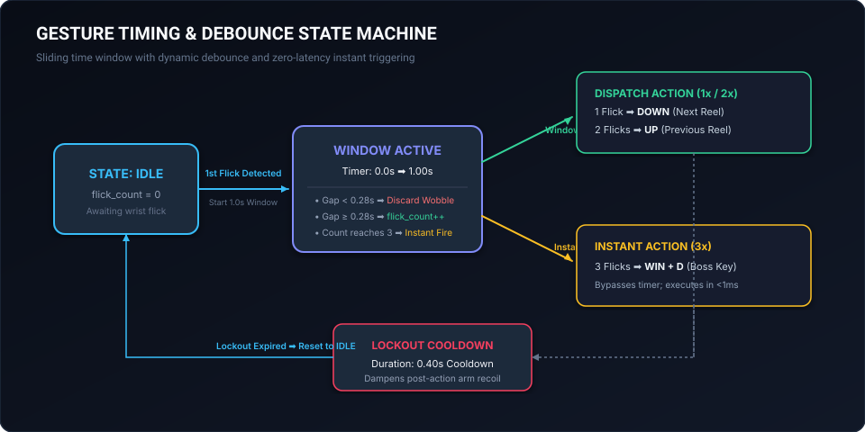

# 🎮 WatchGesture — Wrist Gesture Controller

A high-performance, ultra-low-latency desktop navigation and media automation controller powered by wrist gestures from consumer Bluetooth Low Energy smartwatches.

---

## Table of Contents
1. [Overview & Core Philosophy](#overview--core-philosophy)
2. [Gesture State Machine (FSM)](#gesture-state-machine-fsm)
3. [The Accelerometer Arming Mechanism](#the-accelerometer-arming-mechanism)
4. [Fast Animation Cancellation (0x53 Trick)](#fast-animation-cancellation-0x53-trick)
5. [Built-in Gesture Profiles](#built-in-gesture-profiles)
6. [Dual-Backend Input Execution](#dual-backend-input-execution)
7. [Running & Calibrating](#running--calibrating)

---

## Overview & Core Philosophy

Most budget smartwatches (\$20–\$80) do not stream raw 50Hz/100Hz 3-axis accelerometer data over Bluetooth to prevent battery drain. 

Instead, **WatchGesture leverages vendor firmware camera remote modes (Opcode `0x66`)** to arm the watch's internal hardware G-sensor interrupt. When the user snaps their wrist, the watch firmware detects the rapid acceleration peak and emits an asynchronous notification on characteristic `0000fee3-0000-1000-8000-00805f9b34fb`.

```
[Wrist Snap] ➡️ [G-Sensor Interrupt] ➡️ [BLE Notify 0x66] ➡️ [FSM Engine] ➡️ [Win32 / PyAutoGUI Keystroke]
```

---

## Gesture State Machine (FSM)

<p align="center">
  
</p>

To distinguish deliberate multi-flicks (e.g. double-tap for previous reel, triple-tap for boss key) from wrist rebound, WatchGesture implements a deterministic finite-state machine in [`src/watchgesture/core/engine.py`](../../src/watchgesture/core/engine.py):

### Timing Parameters

| Parameter | Default | Purpose |
|---|---:|---|
| `gesture_window_sec` | `1.00s` | Sliding window opened on the first flick to accumulate additional flicks. |
| `min_gap_sec` | `0.28s` | Minimum required physical spacing between flicks. Discards rapid wrist bounce. |
| `lockout_duration_sec` | `0.40s` | Post-action lockout during which all G-sensor events are ignored. |

### Evaluation Rules:
1. **1 Flick:** Window opens at $T=0$. If no further flicks arrive before $T=1.00\text{s}$, the single-flick action (`Down / Next Reel`) executes, followed by a $0.40\text{s}$ lockout.
2. **2 Flicks:** Second flick arrives at $T \ge 0.28\text{s}$ and $T < 1.00\text{s}$. At $T=1.00\text{s}$, the double-flick action (`Up / Previous Reel`) executes.
3. **3 Flicks (Instant Trigger):** Third flick arrives before window expiration. The engine triggers the Boss Key (`Win + D`) immediately without waiting for the timer to expire.

---

## The Accelerometer Arming Mechanism

Consumer smartwatches running Realtek RTL8762 firmware shut down their camera remote mode after **6 seconds of inactivity** to preserve power.

WatchGesture keeps the accelerometer armed indefinitely by running a background asynchronous heartbeat loop:
- **Packet:** `FE EA 20 06 66 01` (V2 Framing, Opcode `0x66`, Sub-cmd `0x01`).
- **Target Pipe:** `0000fee2-0000-1000-8000-00805f9b34fb` (`WRITE_WITHOUT_RESPONSE`).
- **Interval:** Exactly every `6.0s`.

---

## Fast Animation Cancellation (0x53 Trick)

When the watch detects a wrist flick in camera mode, the firmware normally initiates a 1.4-second on-screen shutter animation (a circular flash and shutter sound). During this animation, the watch ignores further wrist movements.

To bypass this hardware lock:
1. When opcode `0x66` arrives, WatchGesture immediately transmits opcode `0x53` (`CMD_RETURN_HOME`) to `FEE2`.
2. This forces the watch display back to the home watch face, aborting the 1.4s shutter animation.
3. 20ms later, WatchGesture re-sends opcode `0x66`, re-arming the accelerometer instantly.
4. **Result:** Rapid consecutive wrist flicks can be detected with zero animation latency.

---

## Built-in Gesture Profiles

Profiles map gesture counts to concrete desktop keyboard actions:

| Profile ID | Target Application | 1 Flick | 2 Flicks | 3 Flicks (Instant) |
|---|---|---|---|---|
| `reels` *(Default)* | Instagram Reels Web | 👇 `[down]` (Next Reel) | 👆 `[up]` (Prev Reel) | 🛡️ `[win + d]` (Boss Key) |
| `youtube_shorts` | YouTube Shorts / TikTok | ⏭️ `[down]` (Next Short) | ⏮️ `[up]` (Prev Short) | 🛡️ `[win + d]` (Boss Key) |
| `media` | Spotify / VLC / Netflix | ⏯️ `[playpause]` | ⏭️ `[nexttrack]` | 🔇 `[volumemute]` |
| `presentation` | Keynote / PowerPoint | ➡️ `[right]` (Next Slide) | ⬅️ `[left]` (Prev Slide) | ⏹️ `[b]` (Blank Screen) |
| `reading` | Kindle / PDF Viewer | 📄 `[pagedown]` | 📃 `[pageup]` | 🔝 `[home]` |

---

## Dual-Backend Input Execution

Input execution in [`src/watchgesture/core/dispatcher.py`](../../src/watchgesture/core/dispatcher.py) uses a resilient dual-backend system:
1. **Primary Backend (Direct Win32 Hardware Virtual Keys):**
   - Uses `user32.keybd_event` with scancodes via [`src/watchgesture/utils/win32.py`](../../src/watchgesture/utils/win32.py).
   - Injects directly at the Windows driver level, bypassing browser sandboxes and anti-automation hooks.
2. **Fallback Backend (PyAutoGUI):**
   - Cross-platform fallback for macOS and Linux compatibility.

---

## Running & Calibrating

### 1. Launch Desktop GUI
```powershell
python run.py gui
```
- Real-time animated gesture radar.
- Sliders to fine-tune `gesture_window_sec`, `min_gap_sec`, and `lockout_duration_sec`.
- One-click buttons to buzz the watch (`0x61`) or calibrate the accelerometer (`0x52`).

### 2. Run Background Daemon
```powershell
python run.py run --profile reels
```

### 3. Test Local Simulation (No Watch Needed)
```powershell
python run.py simulate --flicks 1
python run.py simulate --flicks 2
python run.py simulate --flicks 3
```
