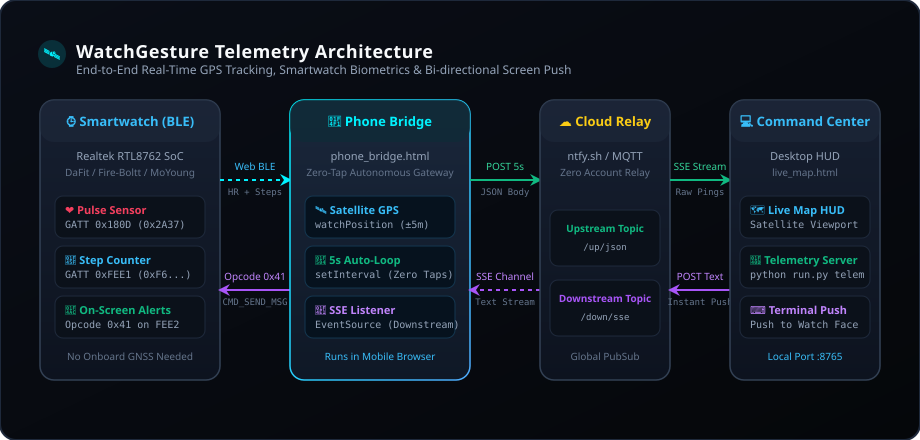

# 🛰️ WatchGesture — Satellite GPS & Biometric Telemetry

An autonomous, zero-tap mobile telemetry bridge and desktop command center for live satellite geolocation and smartwatch health tracking.

---

## Table of Contents
1. [Architecture Overview](#architecture-overview)
2. [The Smartwatch GNSS Problem & Solution](#the-smartwatch-gnss-problem--solution)
3. [Web Bluetooth Sensor Streaming](#web-bluetooth-sensor-streaming)
4. [Cloud Relay PubSub Pipeline](#cloud-relay-pubsub-pipeline)
5. [Desktop Command Center & Live Map HUD](#desktop-command-center--live-map-hud)
6. [Bi-directional Watch Screen Text Injection](#bi-directional-watch-screen-text-injection)
7. [Quickstart Guide](#quickstart-guide)

---

## Architecture Overview

<p align="center">
  
</p>

The telemetry subsystem connects three endpoints in real time:
1. **⌚ Smartwatch (BLE Peripheral):** Emits live pulse (BPM) and step counts over Bluetooth Low Energy.
2. **📱 Mobile Phone Gateway (`phone_bridge.html`):** Runs in the phone browser, pulls high-precision satellite GPS coordinates from the phone's hardware GNSS, aggregates watch biometrics via Web Bluetooth, and beams JSON pings every 5 seconds.
3. **💻 Desktop / Laptop Command Center (`live_map.html`):** Subscribes to the live cloud stream, plots real-time coordinates on an interactive satellite map, and enables sending instant text alerts to the smartwatch face.

---

## The Smartwatch GNSS Problem & Solution

### The Hardware Constraint:
Budget consumer smartwatches (\$20–\$80) almost universally lack an integrated satellite GPS receiver to reduce bill-of-materials cost and prevent rapid battery drain.

### The WatchGesture Solution:
Instead of requiring an expensive dedicated GPS tracker or clunky proprietary companion apps (like Da Fit or GloryFit), WatchGesture uses an **instant mobile web bridge**:
- **Zero App Installation:** The phone bridge runs as a lightweight HTML5 web app (`phone_bridge.html`).
- **Zero-Tap Automatic Acquisition:** As soon as the page opens, `navigator.geolocation.watchPosition` locks onto satellites and begins streaming immediately.
- **Accurate to $\pm 3\text{m}$:** Leverages multi-constellation phone GNSS (GPS, GLONASS, Galileo, BeiDou).

---

## Web Bluetooth Sensor Streaming

The phone bridge connects directly to the smartwatch via the **Web Bluetooth API**:

```javascript
// 1. Connect to Vendor Service 0xFEEA & Standard Heart Rate 0x180D
const device = await navigator.bluetooth.requestDevice({
  filters: [{ services: [0xfeea] }],
  optionalServices: [0xfeea, 0x180d]
});

// 2. Arm Continuous Heart Rate Streaming (Opcode 0x68 {0x00})
await writeChar.writeValueWithoutResponse(makeV2Packet(0x68, new Uint8Array([0x00])));

// 3. Subscribe to Pedometer Characteristic (0xFEE1)
await stepsChar.startNotifications();
stepsChar.addEventListener("characteristicvaluechanged", (e) => {
  const b = new Uint8Array(e.target.value.buffer);
  if (b.length >= 7 && b[0] === 0xF6) {
    steps = b[1] | (b[2] << 8); // Little-endian 16-bit integer
  }
});
```

---

## Cloud Relay PubSub Pipeline

Telemetry uses standard HTTP pub/sub relays (`ntfy.sh` or any self-hosted MQTT/SSE broker) with zero account creation required:

### 1. Upstream Stream (Phone $\to$ PC):
- **Endpoint:** `POST https://ntfy.sh/<upstream_topic>`
- **Payload Schema:**
  ```json
  {
    "lat": 15.369620,
    "lon": 75.132854,
    "acc": 5.0,
    "bpm": 78,
    "steps": 4210,
    "msg": "Auto 5s Telemetry Sync",
    "sos": false,
    "timestamp": "2026-11-08T15:20:00Z"
  }
  ```

### 2. Downstream Stream (PC $\to$ Phone $\to$ Watch Screen):
- **Endpoint:** `GET https://ntfy.sh/<downstream_topic>/sse`
- Real-time Server-Sent Events (SSE) channel delivering instant text messages to the phone, which packages them into Opcode `0x41` packets and transmits them over BLE to the watch.

---

## Desktop Command Center & Live Map HUD

The desktop HUD runs locally on your PC:
- **Interactive Satellite Viewport:** Renders live position with auto-centering on movements greater than 5 meters.
- **Metric Cards:** Real-time display for Latitude/Longitude, GPS Accuracy ($\pm X\text{m}$), Heart Rate, Steps, and Last Sync timestamp.
- **Transmission Log:** Complete millisecond-stamped audit trail of incoming telemetry packets.

---

## Bi-directional Watch Screen Text Injection

WatchGesture can inject arbitrary text alerts directly onto the watch screen (Opcode `0x41` / `CMD_SEND_MESSAGE`):

```
+------------+------------+------------+------------+------------+------------+--------------------+
|    0xFE    |    0xEA    |    0x20    |   Length   |    0x41    |  Type (11) |   "Title:Message"  |
+------------+------------+------------+------------+------------+------------+--------------------+
```

The watch firmware interprets the first colon (`:`) as the delimiter between the notification title and the notification body.

---

## Quickstart Guide

### 1. Start the Telemetry Server on PC:
```powershell
python run.py telemetry
```
*Automatically starts the relay listener, hosts the local web server at `http://localhost:8765`, and opens `live_map.html` in your default browser.*

### 2. Connect Your Phone:
1. Connect your phone to the same Wi-Fi network (or open the public tunnel URL).
2. Open `http://<your-pc-ip>:8765/phone_bridge.html` in Chrome on your phone.
3. Satellite GPS tracking begins automatically.
4. *(Optional)* Tap **"Link Smartwatch BLE"** to stream pulse and steps.

### 3. Send Text to Watch Screen:
Type a message in the desktop HUD or run:
```powershell
python run.py telemetry-send -m "Dinner is ready!"
```
*The watch will buzz and show "PC: Dinner is ready!" on its display.*

